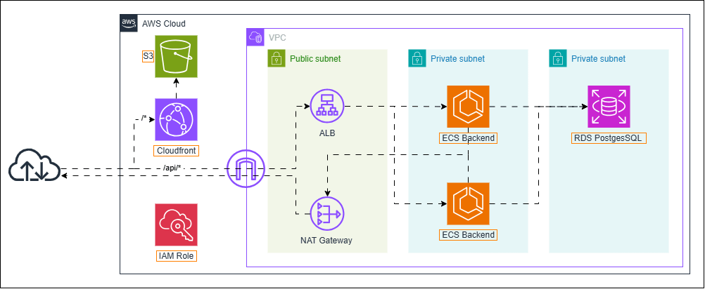

# Cutlink

**Cut the long link. Keep the connection.**

Shorten URLs, choose custom endings, manage links, and track clicks.

React + Vite + TypeScript + Bootstrap · FastAPI + PostgreSQL + Alembic

## Architecture



CloudFront + private S3, ALB, one Fargate API and one RDS PostgreSQL instance. See [architecture and limits](docs/architecture.md).

## Run locally

```powershell
Copy-Item .env.example .env
docker compose up -d --build --wait --wait-timeout 180
```

Open [localhost:5173](http://localhost:5173). Migrations run before the API starts.

Choose `/r/my-portfolio`, or leave the ending blank for a random code. The backend records each click directly in PostgreSQL before redirecting. Invalid URLs and duplicate endings show inline errors.

## Check

```powershell
cd frontend
npm ci
npm run test:run
npm run build
```

Backend tests use PostgreSQL and a disposable `cutlink_test` database. See [local development](docs/local.md) for venv/pip and full test commands.

## CI and CD

```text
push feat/* or PR → CI
merge main       → CI → CD
                         ├─ publish tested image to GHCR
                         ├─ migrate + update Fargate
                         └─ upload tested frontend to S3
```

CI and CD are separate workflows. CD accepts only successful CI for the current main commit. AWS infrastructure is set up once and reused for later releases.

## Guides

- [Local development and tests](docs/local.md)
- [PostgreSQL and migrations](docs/database.md)
- [AWS setup, rollback and teardown](docs/aws.md)
- [GitHub Actions and production variables](docs/github-actions.md)
- [Architecture and limits](docs/architecture.md)

Configure AWS before enabling production releases. Local startup creates no AWS resources.
